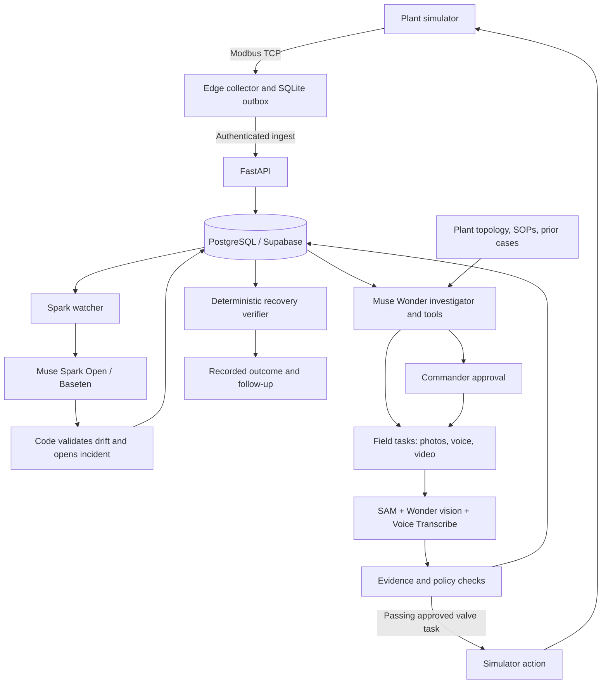

# FAULTGLASS

**An industrial investigation agent that connects telemetry, physical evidence, and verified recovery.**

[**Open the live demo**](https://faultglass-teal.vercel.app/?view=operator) · [**Watch the demo video**](https://youtu.be/WYV7UClJFYk) · [Judge walkthrough](#judge-walkthrough) · [Model map](#where-the-meta-models-run) · [Local setup](#run-locally) · [Tests](#test-the-project)

[](LICENSE)

When production falls but the PLC shows no fault, the explanation may be spread across a flow trend, an analog pressure gauge, a maintenance procedure, and the person beside the equipment. FAULTGLASS brings those observations into one investigation: detect drift, test competing explanations, request missing field evidence, propose an intervention, and check whether the process actually recovers.

Built for plant operators and maintenance engineers working with a mixture of digital instruments and manual equipment. The water-treatment prototype addresses **Push the Frontier**: giving an agent a practical way to understand a physical system through telemetry, vision, speech, and human decisions.

> **Demo scope:** process telemetry and recovery are simulated; model requests are real. Bundled gauge photographs, audio, and lever video are field-evidence samples. Procedures and historical cases are synthetic demonstration records. Actions affect the simulator, not factory equipment.

## Start here

| Entry point | What to inspect |
| --- | --- |
| [Live Commander](https://faultglass-teal.vercel.app/?view=operator) | Start the scenario; follow production, hypotheses, evidence, approval, and recovery. |
| [Demo video](https://youtu.be/WYV7UClJFYk) | Watch the demonstrated workflow before trying it. |
| [Field workspace](https://faultglass-teal.vercel.app/?view=field) | Complete requested photo, audio, and valve-video tasks. Start in Commander first. |
| [Interactive plant](https://faultglass-teal.vercel.app/?view=twin) | Explore equipment, connections, and the investigation's location. |
| [Local setup](#run-locally) | Run the six backend services and React frontend yourself. |
| [Automated verification](#test-the-project) | Choose offline checks, database integration tests, or live-provider checks. |

The hosted workflow uses the project's configured backend; judges do not need to enter model keys in the browser. Use the app's **Commander**, **Field**, and **Plant** navigation during the same run.

## Judge walkthrough

Open [Commander](https://faultglass-teal.vercel.app/?view=operator) and keep the application open while testing. It starts a simulation when no active run exists. If a previous demonstration is in progress, continue it or choose **Demo controls → Reset simulation** for a fresh run. Reset affects the shared demo session.

| Step | What to do | What to verify |
| --- | --- | --- |
| **1. Learn normal operation** | Wait for baseline learning. | Readings and the production trend establish normal operation. The default baseline is 120 simulated seconds: approximately 12 real seconds at 10× speed, plus polling. |
| **2. Introduce the problem** | **Demo controls → Start production decline**. | Production falls while related pressures, motor current, and water quality drift. PLC fault states can remain normal. |
| **3. Inspect the investigation** | Follow the incident. Open **Hypotheses → Expand map** and the **Investigation thread**. | Spark's validated flag leads to Wonder's investigation. Inspect recorded hypotheses, tool activity, retrieved context, and focus. |
| **4. Supply missing observations** | When gauges are requested, open **Field**. Click **Use demo inlet photo** for PI-201 and **Use demo outlet photo** for PI-202. Optionally select **Use demo audio**. | Each file appears in the matching capture area. Sample controls appear only in the relevant pending task. |
| **5. Analyze evidence** | Click **Submit gauge evidence**. | SAM isolates the dials, Wonder reads psi, and Python computes the differential. Supplied audio is transcribed, structured, and compared with accepted photo readings. |
| **6. Approve an intervention** | Return to Commander. Inspect the proposed action and click **Approve backwash** when available. | Proposal and human approval are separate steps. Approval issues the valve task. |
| **7. Check physical handling** | Field → **Use demo lever video → Submit for verification**. | SAM tracks the lever and hand. Code evaluates the movements and intermediate hold. A passing result acknowledges the simulator action. |
| **8. Check the outcome** | Return to Commander and wait for verification. | The verifier records the measured recovery percentage and maintenance follow-up. The UI shows the recorded result, not a fixed success message. |

**Selecting a sample does not submit it or call a model.** Submit uses the same backend analysis as a user-selected file. All four samples are committed in [frontend/public/demo/](frontend/public/demo/); judges may also supply their own media.

Live model processing is not accelerated by the simulation clock. Gauge analysis and video tracking can take minutes; progress remains visible. Model wording and decisions may vary. Insufficient evidence can lead to a retake or escalation.

Use the evidence/approval path above for evaluation. **Simulator utilities → Record backwash complete** is a setup shortcut that bypasses evidence verification.

### If the demo appears to wait

| Situation | What to check |
| --- | --- |
| Start production decline is disabled | Wait for baseline learning and a connected backend. An existing scenario needs a reset before another can start. |
| Field shows no task | Expected until Wonder requests evidence. Follow the incident in Commander first. |
| Files are selected but nothing happens | Review them, then press Submit. Selection alone makes no request. |
| A gauge needs a retake | Replace the requested photo. Previously accepted readings are retained. |
| Video is uncertain or violates policy | Review the reasons and supply another clip. The action is not acknowledged on a failed check. |
| Connection is interrupted | Use the retry control. Selected files and notes remain available in the current form. |
| Recovery is not yet recorded | A passing clip starts a separate telemetry-verification stage. Keep the app open for the simulation heartbeat. |

## Judging rubric: evidence to inspect

Weights follow the [official event waiver's project-judging rubric](https://cerebralvalley.ai/e/meta-ai-developer-hackathon/waiver). This maps evaluation criteria to inspectable work; it does not award the project its own score.

| Official criterion | Weight | Evidence in FAULTGLASS | Where to verify |
| --- | ---: | --- | --- |
| **Impact** | **30%** | A concrete maintenance workflow connecting fragmented observations, preserving handoffs, and checking intervention outcomes. Intended benefit: shorter, more traceable investigations without digitizing every manual gauge. | [Problem and value](#the-problem-and-the-value), [live workflow](https://faultglass-teal.vercel.app/?view=operator), [plant pack](plants/waterplant/). Operational time/cost savings have not yet been measured. |
| **Use of Meta AI Tooling** | **25%** | Four Meta model families with distinct runtime jobs: Spark detects drift; Wonder investigates and interprets evidence; SAM segments/tracks objects; Voice Transcribe captures speech. | [Model map](#where-the-meta-models-run), [Spark](backend/app/watcher/spark.py), [Wonder](backend/app/investigator/wonder.py), [SAM](backend/app/evidence/sam.py), [voice](backend/app/evidence/voice.py). |
| **Technical Depth & Execution** | **20%** | Modbus ingestion, durable investigation, evidence-gated proposals, human approval, camera-compensated lever analysis, deterministic recovery, and correlated model-call logs. | [Engineering decisions](#what-distinguishes-the-implementation), [architecture](#architecture), [tests](#test-the-project), [observability](#inspect-real-model-call-telemetry). |
| **Demo** | **25%** | Hosted product, video, exact walkthrough, contextual bundled samples, progress/retry states, and a recovery outcome grounded in measurements. | [Live demo](https://faultglass-teal.vercel.app/?view=operator), [video](https://youtu.be/WYV7UClJFYk), [walkthrough](#judge-walkthrough), [field forms](frontend/src/components/field/TaskForms.tsx). |

The project addresses the physical-systems/manufacturing direction of **Push the Frontier** and uses Meta models in the running application. Original application work and third-party foundations are identified in [Hackathon contributions](#hackathon-contributions-and-provenance).

## The problem and the value

An operator can see production dropping without enough evidence to identify the cause. Streamed instruments show part of the process; analog gauges and manual valves supply another part. Procedures and prior incidents explain what readings mean at that plant. A worker's spoken observation often never becomes structured evidence.

FAULTGLASS turns the investigation into a shared record:

- **Operators:** specific next checks, linked equipment, and field evidence capture.
- **Maintenance engineers:** competing hypotheses, cited measurements, plant context, and explicit intervention prerequisites.
- **Approvers:** an evidence-backed proposal followed by a separate, measured outcome.

The scenario takes permeate flow from roughly **2,000 to 1,500 L/h**. Related signals move together while PLC fault states remain normal. A photographed cartridge-bank pressure differential supplies evidence unavailable in the streamed measurements. Backwash produces deliberately partial recovery, retaining cartridge replacement and upstream inspection as follow-up.

The value hypothesis is reduced investigation and handoff time. The repository demonstrates the workflow; it does not claim measured downtime savings, diagnosis accuracy across arbitrary plants, or a production deployment in an operating factory.

## Where the Meta models run

| Model and provider | Input → model responsibility → output | What deterministic code owns | Source |
| --- | --- | --- | --- |
| **Muse Spark Open / Baseten** `meta-models/muse-spark-open-1026` | Computed telemetry card → assess coordinated drift → `NORMAL`, `WATCH`, or `FLAG` with cited tags. | Statistics, freshness, deviation checks, validated flags, incident creation. Spark does not diagnose causes. | [Client](backend/app/watcher/spark.py) · [Cards](backend/app/watcher/card.py) · [Worker](backend/app/watcher/worker.py) |
| **Muse Wonder / Meta Model API** `muse-wonder-1.0` | Incident/tool results → investigate and choose checks; masked dials → psi readings; transcripts → structured observations. | Tool execution, persistence, numeric validation, differential, speech/photo comparison, budgets, action prerequisites. | [Client](backend/app/investigator/wonder.py) · [Loop](backend/app/investigator/worker.py) · [Tools](backend/app/investigator/tools.py) · [Gauges](backend/app/evidence/gauge.py) · [Voice](backend/app/evidence/voice.py) |
| **SAM 3.1 / Meta Model API** `sam-3.1` | Photos/video and concept prompts → locate dials, handles, hands, reference objects → boxes and masks across frames. | Mask decoding/cropping, track association, camera compensation, movement segmentation, policy. SAM does not read psi or measure valve angles. | [Client](backend/app/evidence/sam.py) · [Tracking](backend/app/evidence/lever.py) · [Policy](backend/app/evidence/valve.py) |
| **Muse Voice Transcribe / Meta Model API** `muse-voice-transcribe-1.0` | WAV audio with Marathi/English bias and vocabulary hints → speech recognition → transcript and metadata. | Audio preparation, routing transcripts to Wonder, numerical agreement with photo readings. | [Speech pipeline](backend/app/evidence/voice.py) · [Audio preparation](frontend/src/lib/media.ts) |

Spark uses Baseten's `/chat/completions` endpoint with low reasoning effort and a 1,024-token output limit. Wonder uses Meta's `/responses` with `store: false` and opaque encrypted continuation replay. SAM uses streaming Responses and Meta's `meta_sam_parser`. Voice uses `/asr/transcribe` in `PUSH_TO_TALK` mode.

These are runtime integrations with explicit responsibilities. Muse Image, Muse Glimmer, and a runtime Muse Code verifier are not part of the implemented workflow.

## What distinguishes the implementation

### Investigation continues across field work

Wonder's tools retrieve stored telemetry/windows, flag evidence, plant memory, SOPs, prior incidents, and graph neighbours; record hypotheses/focus; request field tasks; and propose actions. It checks available observations before requesting another measurement.

PostgreSQL persists hypotheses, tool activity, focus, and continuation checkpoints. Field evidence resumes the same incident. Field-only instruments explicitly require field evidence; the investigation tools do not expose simulator ground truth. Default budgets allow 12 model turns per segment and 36 overall before escalation.

The interface shows recorded summaries, tool results, and hypotheses. Encrypted continuation is replayed intact and is not exposed as internal reasoning. See the [investigation loop](backend/app/investigator/worker.py) and [tool contracts](backend/app/investigator/tools.py).

### Multiple evidence types check one another

- **Gauge photos:** SAM isolates each dial; Wonder reads the red psi scale. Python computes **PI-201 inlet − PI-202 outlet**. The configured normal differential is 8 psi; the restriction gate is 12 psi. Unreadable or ambiguous evidence requires another observation.
- **Worker speech:** the browser prepares mono 24 kHz, 16-bit PCM WAV. Voice Transcribe transcribes it; Wonder extracts explicitly stated readings; Python returns `AGREE`, `DISAGREE`, `PARTIAL`, or `AWAITING_PHOTO`. Comparison tolerance is the greater of 2 psi or 10% of the photo reading's magnitude.
- **Lever video:** SAM tracks handles and the hand. Code compensates for camera translation and accounts for occlusion/re-gripping, then checks two hand-driven movements, a still intermediate hold of at least two seconds, and distinct rest positions.

Video policy returns `passed`, `violated`, or `uncertain`. It evaluates the movement sequence; it does not establish an absolute 45° position or prove a final closed state. Implementation: [gauge evidence](backend/app/evidence/gauge.py), [voice comparison](backend/app/evidence/voice.py), [lever geometry](backend/app/evidence/lever.py), [policy](backend/app/evidence/valve.py).

### Proposal, approval, execution, and verification are separate

The supported intervention is **V-113 backwash**. Proposal requires a supported hypothesis and recorded inlet/outlet readings from a completed gauge task meeting the differential gate. In the demonstrated UI workflow, those readings come from the submitted photographs. Commander approval dispatches a task; passing lever evidence acknowledges the simulator action.

Only the [Python verifier](backend/app/verifier/worker.py) resolves the live incident. After settling and a sustained measurement window, it checks flow recovery to at least 88% of configured nominal flow, improvement of at least 200 L/h over the pre-action level, recovery of four related measurements, and absence of abnormal plant states. Its reported recovery percentage uses the configured nominal flow; Spark's drift detection uses the learned run baseline. The verifier records the outcome and remaining maintenance work. A model conclusion or checklist alone cannot close the incident.

## Architecture



The watcher reads persisted telemetry, not the simulator directly. Shared equipment identifiers connect the plant scene, investigation tools, and field tasks, letting the interface locate the equipment involved in a check.

| Layer | Implementation |
| --- | --- |
| Web app | React, TypeScript, Vite, Three.js; Commander, Field, Plant; SSE with polling fallback. |
| Backend | Python/FastAPI; separate API, simulator, edge, watcher, investigator, verifier processes. |
| Data | PostgreSQL/Supabase: telemetry, incidents, hypotheses, tasks, evidence metadata, approvals, checkpoints. |
| Plant definition | YAML manifest, equipment, instruments, topology, routes, register mappings in [plants/waterplant/](plants/waterplant/). |
| Hosting | Vercel frontend; six AWS Lightsail containers using one backend image built through GitHub Actions. |
| Model telemetry | Structured Wonder/Spark events and an optional CloudShell-to-CloudWatch collector. |

## Test the project

Choose the level you want to inspect. Automated tests use fake provider responses; live-provider checks are explicitly separate.

| Check | Requirements | What it verifies |
| --- | --- | --- |
| Hosted walkthrough | Browser and reachable demo/backend/providers | Complete runtime workflow with real model requests and sample media. |
| Focused backend suite | Python/uv and dependencies; no database server or model keys | HTTP-boundary logs, failures, correlation, metadata filtering, collector behavior. |
| Full backend suite | Dependencies; permission to run temporary PostgreSQL and local sockets | API/database, edge buffering, run lifecycle, persistent investigation, evidence, policy, recovery. |
| Frontend tests/build | Node.js/npm; no model keys | State/presentation logic, TypeScript checking, production bundling. |
| Live Spark check | Baseten key and network | Real classifications and complete-response timing. |

### Offline checks

From `backend/`:

```bash
uv sync --frozen

# Isolated unit directory: no PostgreSQL server or provider requests.
uv run pytest --confcutdir=../tests/unit ../tests/unit -q

# Full suite: pgserver creates temporary PostgreSQL databases.
uv run pytest -q
```

The full suite applies migrations to isolated databases; it does not use the production database or require model keys. The environment must permit PostgreSQL executables, child processes, temporary writes, and local sockets. On Linux, run PostgreSQL as a normal non-root user. FFmpeg/ffprobe exercise normalization; that check skips if FFmpeg is unavailable.

From `frontend/`:

```bash
npm ci
npm test
npm run build
```

The collector has a Python-standard-library-only test, runnable from the repository root:

```bash
python3 -m unittest discover -s tests/unit -p test_cloudwatch_forwarder.py -v
```

Source checks: [watcher](tests/test_watcher.py), [investigator](tests/test_investigator.py), [gauges](tests/test_evidence.py), [lever motion](tests/test_lever_motion.py), [voice/recovery](tests/test_valve_voice.py), [edge](tests/test_edge.py), [observability](tests/unit/test_model_observability.py).

### Live Spark smoke check

This makes paid/credited provider requests using a configured Baseten key. It needs no database or private media. From `backend/`:

```bash
uv run --env-file ../.env python scripts/smoke_spark.py \
  --repeat 3 --output ../docs/benchmarks/spark-local.json
```

Inspect verdicts, validated tags, and timing. `scripts/smoke_meta.py` references private local recordings absent from a fresh clone; use the hosted field workflow and committed samples to evaluate multimodal processing.

### Retained live benchmark

The [3 November 2026 Spark report](docs/benchmarks/spark-2026-11-03.json) retains all six sequential requests, exact synthetic cards, settings, and responses. No warm-up was excluded.

| Case | Requests | Returned verdicts | Full-response median |
| --- | ---: | --- | ---: |
| Healthy card | 3 | `NORMAL` × 3 | 3,625 ms |
| Production-decline card | 3 | `FLAG` × 3; deviations passed code checks | 2,027 ms |
| Combined | 6 | Expected verdict in each case | 3,117 ms |

Range: 1,961–8,451 ms. Timing includes network, provider processing, and response generation. It is not time to first token or end-to-end detection time, which also depends on sampling, the recent window, and watcher cadence. This small sample is a retained demonstration observation, not a diagnosis-accuracy benchmark or latency guarantee.

## Run locally

### Prerequisites

- Python 3.12 and [uv](https://docs.astral.sh/uv/).
- Node.js 22 and npm.
- PostgreSQL or Supabase PostgreSQL, plus `psql`.
- FFmpeg/ffprobe for video normalization.
- Meta Model API access for Wonder, SAM, Voice Transcribe; Baseten access for Spark.

The live workflow uses external services. Offline checks require no provider keys.

### 1. Install and configure

From the repository root:

```bash
cp .env.example .env
cd backend
uv sync --frozen
```

Edit the root `.env` before starting services:

| Setting | Value or purpose |
| --- | --- |
| `DATABASE_URL` | Your PostgreSQL connection string. |
| `MODEL_API_KEY` | Meta Model API key. |
| `BASETEN_API_KEY` | Baseten key with access to `meta-models/muse-spark-open-1026`. |
| `PLANT_DIR` | **`../plants/waterplant`** when running from `backend/`. Override the root-relative example value. |
| `CORS_ORIGINS` | `http://localhost:5173`. |
| `API_URL` | `http://127.0.0.1:8000` for edge delivery. |
| `EDGE_NODE_ID` | `EDGE-01`; provision its key below. |
| `EDGE_API_KEY` | Generated by provisioning. |
| `UPLOAD_DIR` | `../uploads` from `backend/`, placing captures in the ignored root uploads directory. |

Other endpoints, models, intervals, and simulator settings appear in [.env.example](.env.example). Model credentials belong in backend configuration, not frontend source.

### 2. Initialize a fresh database

These Bash/WSL commands run from the repository root. Export `DATABASE_URL` with the same value placed in `.env`; `psql` does not load that file automatically.

```bash
export DATABASE_URL='YOUR_POSTGRES_CONNECTION_STRING'

(
set -e
for migration in supabase/migrations/*.sql; do
  psql "$DATABASE_URL" -v ON_ERROR_STOP=1 -f "$migration"
done
for seed in supabase/seed/*.sql; do
  psql "$DATABASE_URL" -v ON_ERROR_STOP=1 -f "$seed"
done
)
```

Apply every migration before seeding. Seeds create the demonstration plant, procedures, and prior incidents; they target an empty database and are not an idempotent reset command.

Provision the edge node:

```bash
cd backend
uv run --env-file ../.env python -m app.edge.provision EDGE-01
```

Copy its generated key into `.env` as `EDGE_API_KEY`.

### 3. Start all six backend services

Run **each command in its own terminal**, with `backend/` as its working directory:

```bash
uv run --env-file ../.env python -m app.api
uv run --env-file ../.env python -m app.simulator
uv run --env-file ../.env python -m app.edge
uv run --env-file ../.env python -m app.watcher
uv run --env-file ../.env python -m app.investigator
uv run --env-file ../.env python -m app.verifier
```

The API does not start the other processes. It listens on port 8000; the simulator exposes Modbus on 5020. Explicit `--env-file` loads configuration for each process.

### 4. Start the frontend

In another terminal, from the repository root:

```bash
cd frontend
npm ci
npm run dev
```

Open [local Commander](http://localhost:5173/?view=operator) and follow the [walkthrough](#judge-walkthrough). The API defaults to `http://127.0.0.1:8000`; set `VITE_API_URL` for another backend. A basic API check is `curl http://127.0.0.1:8000/v1/healthz`.

Validate the plant pack and rebuild its scene:

```bash
cd backend
uv run python -m app.plant validate ../plants/waterplant
cd ../frontend
npm run plant
```

## Inspect real model-call telemetry

[Structured events](backend/app/observability.py) record actual Wonder/Spark request starts, successes, and failures: provider/model, call ID, duration, HTTP status, provider request ID, returned token usage, correlation IDs, and declared Wonder tool names. Spark assessments add numerical current/baseline measurements, validated tags, verdicts, and outcomes.

The model events exclude API keys, prompts, response bodies, tool arguments, transcripts, and internal/encrypted reasoning. Current instrumentation covers Wonder and Spark; direct SAM and Voice Transcribe requests are not yet in this event stream. HTTP success and an accepted application verdict remain separate events.

Lightsail exposes `api`, `watcher`, and `investigator` logs separately. Combine their events for a recording by running this from the checkout in AWS CloudShell after deploying the instrumented image:

```bash
python3 deploy/forward_model_logs.py \
  --region eu-west-3 --service faultglass \
  --group /faultglass/model-calls --initialize
```

Keep the collector and CloudShell active. In CloudWatch, use the same region, open **Logs → Live Tail**, select **`/faultglass/model-calls`**, and start. Polling and ingestion add delay; this is a demo-session collector, not permanent log collection. See [setup, permissions, queries, and recording instructions](docs/MODEL_LOGGING.md). A [PowerShell alternative](deploy/forward-model-logs.ps1) is included.

## Hackathon contributions and provenance

Original FAULTGLASS application work includes the plant pack/simulator, Modbus/edge ingestion, Spark watcher, persistent Wonder investigation/tools, multimodal evidence pipelines, proposal/approval/recovery workflow, Three.js operator interfaces, contextual sample controls, and model-call instrumentation.

The [commit history](https://github.com/Shantanu-00/FAULTGLASS/commits/main/) records development from initial application commit [`c18e2c0`](https://github.com/Shantanu-00/FAULTGLASS/commit/c18e2c0) on 2 November 2026 through asset/logging commit [`95f8535`](https://github.com/Shantanu-00/FAULTGLASS/commit/95f8535), timestamped **4 November 2026, 16:21 EST**. Its local timestamp is 5 November, 02:51 IST; both identify the same instant. This README is evaluation documentation for the implemented application.

Third-party foundations are separate: React/Three.js, FastAPI/httpx, PostgreSQL, Modbus libraries, Meta's SAM parser, model services, and other declared dependencies. Vendor documentation/cookbook examples under `docs/meta/` are reference material, not original FAULTGLASS features. Manifests and lockfiles identify the dependencies used.

## Current boundaries and next steps

| Current boundary | Next engineering step |
| --- | --- |
| One demonstrated water-treatment scenario and supported intervention | Evaluate other faults, conflicting evidence, and plant packs against retained labelled cases. |
| Simulated response and approximate plant geometry | Validate site-specific models and instrument mappings with plant engineers. |
| Commander/Field are interface views; console workflows lack user authentication/RBAC | Add authenticated users, plant membership, and server-enforced approval permissions. Edge ingest already uses provisioned node keys. |
| Uploaded media uses temporary container-local storage and can disappear on redeploy | Add durable private object storage and evidence lifecycle controls. Investigation metadata persists separately in PostgreSQL. |
| Small Spark timing sample; no retained noisy-audio or broad diagnosis benchmark | Evaluate unreadable gauges, contradictory speech, occlusion, failed actions, and incomplete recovery. |
| Demo-session CloudWatch forwarding | Add persistent collection and instrument direct SAM/Voice requests. |

## Repository guide

| Path | Responsibility |
| --- | --- |
| [backend/app/api/](backend/app/api/) | API, ingestion, incidents, evidence submission. |
| [backend/app/edge/](backend/app/edge/) | Modbus polling, local outbox, uplink, node provisioning. |
| [backend/app/watcher/](backend/app/watcher/) | Spark, telemetry cards, validation, flags. |
| [backend/app/investigator/](backend/app/investigator/) | Wonder, tools, focus, durable continuation. |
| [backend/app/evidence/](backend/app/evidence/) | SAM, gauges, speech, lever tracking, policy. |
| [backend/app/verifier/](backend/app/verifier/) | Deterministic recovery checks. |
| [backend/app/simulator/](backend/app/simulator/) | Plant dynamics, Modbus state, action response. |
| [frontend/](frontend/) | Commander, Field, interactive plant. |
| [frontend/public/demo/](frontend/public/demo/) | Committed photos, audio, lever video. |
| [plants/waterplant/](plants/waterplant/) | Plant manifest, instruments, topology, routes. |
| [supabase/](supabase/) | Migrations and synthetic demonstration records. |
| [deploy/](deploy/) | Lightsail configuration and CloudWatch collectors. |
| [tests/](tests/) · [frontend/tests/](frontend/tests/) | Backend and frontend verification. |
| [docs/benchmarks/](docs/benchmarks/) | Retained live-provider timing evidence. |

Further notes: [Spark watcher](docs/SPARK_WATCHER.md), [Wonder investigator](docs/INVESTIGATOR.md), [SAM/gauge evidence](docs/SAM_EVIDENCE.md), [valve and voice](docs/VALVE_VOICE_FIELD.md), [model logging](docs/MODEL_LOGGING.md). Earlier planning documents may describe superseded designs; linked source and this walkthrough describe the current implementation.

## Contributing

Open an issue with the problem, expected behavior, and a reproducible non-sensitive example. Submit focused pull requests with appropriate verification. New plant support should introduce a validated plant pack and explicit procedures instead of embedding site-specific assumptions in the investigation core. Include evidence-failure cases alongside successful examples.

## License and attribution

Original FAULTGLASS code is available under the [MIT License](LICENSE). Third-party dependencies and mirrored documentation/examples retain their own licenses and notices. Model APIs and hosted services have separate provider terms. Bundled media is included for evaluating the demonstration.
