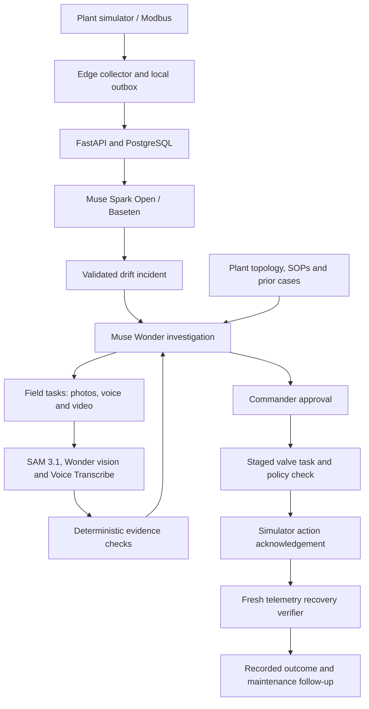

# FAULTGLASS

[](LICENSE)

**Industrial fault investigation that connects telemetry, physical evidence and verified recovery.**

A production line can lose output while its PLC still reports normal operation. Flow, pressure, motor current and water quality may each tell part of the story; the decisive evidence may be on an analog pressure gauge or a manually operated valve with no digital connection. Finding the cause requires someone to connect those signals, understand the plant, consult procedures and check what actually happened in the field.

FAULTGLASS brings that investigation into one workflow. Muse Spark Open on Baseten flags coordinated drift. Muse Wonder investigates competing explanations using plant topology, telemetry and retrieved procedures. A worker supplies the missing photos, Marathi voice observations and valve recordings. SAM 3.1 isolates gauges and tracks physical movement, while deterministic code checks measurements, action prerequisites and recovery.

The intended impact is faster, more traceable troubleshooting for plants with a mixture of digital instruments and manual equipment, without requiring every gauge and valve to be retrofitted first. The current demonstration covers a water-treatment plant and a supported backwash intervention.

## Technical highlights

- **SAM 3.1 verifies staged lever handling.** Video masks of valve handles and the worker's hand become a motion timeline. Code distinguishes two deliberate movements with a real intermediate hold from one continuous turn, camera movement or re-gripping.
- **Wonder sustains an investigation across field work.** Goals, hypotheses, evidence, focus and continuation state persist between model calls and worker responses. New evidence resumes the existing investigation.
- **Spark connects drift across separate signals.** Production, pressure, current and water-quality changes can trigger an incident even when PLC fault states remain normal. A live six-request Baseten test measured a **2.03 s median for decline classification** and **3.12 s overall**; [method and individual results](#measured-baseten-spark-latency) are below.
- **Pressure evidence is calculated from photographed gauges.** SAM isolates each requested dial, Wonder reads its psi scale, and Python computes the inlet-to-outlet differential.
- **Marathi observations become checked evidence.** Muse Voice Transcribe produces the transcript; Wonder extracts the stated readings; code compares them with the accepted photo readings.
- **Recovery is verified from telemetry.** A model explanation or completed checklist cannot close an incident by itself.

## The demonstration

The scenario uses **simulated telemetry**, real plant gauge photos and valve recordings, and a browser-rendered plant twin. It demonstrates an investigation workflow rather than a validated hydraulic model or autonomous control of an operating factory. Procedures and past cases supplied with the repository are synthetic demonstration records.

| Step | What happens |
| --- | --- |
| Detect | Permeate flow falls from about 2,000 to 1,500 L/h. Pressure and motor current fall while TDS rises; PLC fault states remain normal. Spark raises a validated drift flag. |
| Investigate | Wonder checks plant connections, operating data, procedures and prior cases, then develops and revises possible causes. |
| Inspect | The worker photographs the cartridge-bank inlet gauge, PI-201, and outlet gauge, PI-202. Accepted readings produce a pressure differential. A Marathi voice note can add a second observation. |
| Propose | Sufficient evidence permits Wonder to propose the supported V-113 backwash procedure. Commander approval is required before the valve task is issued. |
| Check handling | The worker records the staged lever operation. SAM tracks the handle and hand; Python checks the movement sequence and hold. |
| Verify | A passing action updates the simulator. The verifier checks fresh recovery telemetry before recording the outcome. |
| Follow up | The demonstration recovers to roughly 92% of baseline and retains cartridge replacement and upstream media inspection as follow-up work. The interface displays the percentage actually recorded by the verifier. |

## How the Meta models are used

| Model | Role in FAULTGLASS | Implementation |
| --- | --- | --- |
| **SAM 3.1** — `sam-3.1` | Segment and track handles and hands in valve video; isolate pressure-gauge dials in photographs. | [SAM client](backend/app/evidence/sam.py), [lever tracking](backend/app/evidence/lever.py), [valve policy](backend/app/evidence/valve.py) |
| **Muse Wonder** — `muse-wonder-1.0` | Lead the investigation, retrieve context, maintain hypotheses and focus, read masked gauge images, and structure transcribed observations. | [Investigator](backend/app/investigator/), [gauge reader](backend/app/evidence/gauge.py), [voice observations](backend/app/evidence/voice.py) |
| **Muse Spark Open on Baseten** — `meta-models/muse-spark-open-1026` | Classify computed telemetry summaries as `NORMAL`, `WATCH` or `FLAG`, naming the signals that moved. | [Watcher](backend/app/watcher/), [Baseten client](backend/app/watcher/spark.py) |
| **Muse Voice Transcribe** — `muse-voice-transcribe-1.0` | Transcribe short Marathi, English or mixed-language field recordings with plant-specific vocabulary hints. | [Speech pipeline](backend/app/evidence/voice.py), [browser audio preparation](frontend/src/lib/media.ts) |

### SAM 3.1: staged valve movement verification

The valve workflow checks **how the lever was handled**, rather than accepting a worker's completion claim. SAM tracks valve handles and the worker's hand in parallel. Python associates tracks across frames, uses untouched handles or a pipe as a fixed reference to compensate for camera translation, and excludes hand-covered pixels that could otherwise make re-gripping look like movement.

The resulting timeline must show:

1. A visible, still starting position.
2. A hand-driven movement to a distinct partial position.
3. A genuinely still intermediate hold of **at least two seconds**.
4. A second hand-driven movement to a distinct final position, followed by rest.

The policy returns `passed`, `violated` or `uncertain`, with reasons and timing evidence. One continuous turn violates the staged rule. Missing reference objects, poor visibility, ambiguous handles or a clip that ends during movement prevent a pass. Phone clips are normally prepared as 10 fps, up to 540p MP4 before analysis.

This is motion verification: the implementation does not measure a 45-degree stop or establish the valve's absolute closed state from video. The task identifies the intended valve, and subsequent telemetry establishes the process outcome. Only a passing policy result can acknowledge the simulated backwash action.

### Muse Wonder: an investigation that survives interruptions

Wonder starts with the incident brief and an explicit goal: explain the production drift and find an evidence-supported next action. Through the Meta Responses API, it selects tools to retrieve plant structure, upstream and downstream connections, instrument observability, current and windowed telemetry, SOP sections and prior incident records.

The investigation keeps several explanations in play, such as insufficient feed, pump trouble, cartridge restriction or a membrane-related problem. Wonder records evidence for and against each hypothesis and changes its status through `open`, `rejected`, `supported` and `confirmed`. Its focus ledger preserves the **goal, current blocker, next step and relevant assets**, making the investigation's progress visible in Commander.

Available telemetry is checked before requesting field work. When an instrument is only observable in person, the tool returns that a field task is required. The current plant workflow explicitly requests PI-201 and PI-202; their values are not available to the investigator through the simulator's private state. Once the required field task is completed, the investigator resumes the same incident with accepted measurements and any attached voice observation, rather than starting the diagnosis again. A standalone voice note enriches the record without completing the pending task.

PostgreSQL stores hypotheses, field tasks, focus checkpoints, tool results and the investigation trace. Responses use `store: false`; returned opaque encrypted reasoning items are persisted and replayed for continuation. Public explanations come from recorded summaries and tool activity, not exposed internal reasoning.

The loop is bounded: by default, each segment has a 12-step model budget and an incident has a 36-step overall budget before escalation. This supports long tasks with pauses, evidence collection and re-planning; it is not a claim of unlimited unattended operation. The currently implemented plant-changing proposal is V-113 backwash, gated by accepted pressure evidence and Commander approval.

### Muse Spark Open on Baseten: drift beyond a single alarm code

Spark addresses a practical gap between individual alarms and a production problem spread across several measurements. It can connect lower permeate flow, lower pump current, changed suction and discharge pressures, and higher TDS even while the PLC continues to report running equipment and no fault code. It does not need a named PLC alarm for that combined pattern.

Python builds the evidence card: learned baseline, recent mean, spread, percentage change, statistical distance and freshness for each signal, plus discrete equipment states. The watcher uses a 30-second recent window and a configurable polling interval, defaulting to 10 seconds between iterations. Spark judges the compact card and returns a plain-text verdict and cited tags.

Requests use Baseten's OpenAI-compatible `POST https://inference.baseten.co/v1/chat/completions`, `reasoning_effort: low` and a 1,024-token output limit. Python parses the response and checks the cited deviations against the card before persisting a flag or opening an incident. The current statistical gates are 3 sigma or 5% for watch-level drift and 5 sigma or 10% for flag-level drift; stale measurements cannot support a flag.

Spark provides an evidence-grounded escalation across signals. Wonder owns cause investigation. The demonstration does not establish detection of arbitrary unseen faults or replace the plant's protection systems.

### Pressure gauges: SAM masks, Wonder reads, code compares

The field task requests **multiple gauges as separate photographs**: one clear view of PI-201 at the cartridge-bank inlet and another of PI-202 at the outlet. Each image should include the complete dial, legible scale and needle, with enough detail to distinguish the needle tip from its counterweight.

SAM's pressure-gauge prompt returns the dial mask and bounding box. Python blanks the surrounding image, crops and enlarges the dial, then Wonder reads the red psi scale. Unreadable, missing or ambiguous evidence remains unresolved. A photo containing two similarly sized dials is rejected as ambiguous rather than assigning an arbitrary gauge reading.

Accepted measurements retain their evidence references. Python calculates:

```text
pressure differential = PI-201 inlet pressure − PI-202 outlet pressure
```

For this plant, the normal differential is about 8 psi; the configured restriction threshold is 12 psi. That calculated differential is a prerequisite for a backwash proposal. SAM does not read the scale or calculate the pressure difference.

### Marathi audio in a noisy plant

The Field Companion lets a worker record or upload an observation in Marathi, English or mixed speech while standing near the equipment. In the team's reported factory demonstration, Marathi observations remained usable amid background machinery noise. This is a qualitative field observation; a retained, annotated noisy-Marathi accuracy benchmark is not yet included in the repository.

Audio passes through a concrete processing chain:

1. The browser decodes the recording, mixes it to mono, resamples to **24 kHz**, and encodes **16-bit PCM RIFF/WAV**.
2. Muse Voice Transcribe receives the recording in `PUSH_TO_TALK` mode with Marathi/English language bias and keywords such as PI-201, PI-202, cartridge, pressure and psi.
3. Wonder structures the transcript into explicitly stated gauge values, an English observation and any concerns, without filling in missing measurements.
4. Python compares spoken values with accepted photo readings using a tolerance of the greater of 2 psi or 10% of the photo reading. It returns `AGREE`, `DISAGREE`, `PARTIAL` or `AWAITING_PHOTO`.
5. The transcript, structured observation, comparison, model metadata and audio evidence reference become part of the investigation record.

Language and vocabulary hints help contextual transcription; the current application does not contain a separate denoising stage. A disagreement is retained as evidence to revisit. A failed voice submission does not discard a valid gauge photo.

## Measured Baseten Spark latency

A live test on **3 November 2026** sent six sequential requests through the production Spark client: three healthy cards and three production-decline cards, alternating cases. Inputs were synthetic telemetry matching the demonstration, with PLC states normal in both cases. The test made no database writes and did not affect the running incident.

| Input | Requests | Returned verdicts | Request latencies | Median |
| --- | ---: | --- | --- | ---: |
| Healthy baseline | 3 | `NORMAL` × 3 | 8,451 / 3,112 / 3,625 ms | **3,625 ms** |
| Production decline | 3 | `FLAG` × 3 | 3,122 / 2,027 / 1,961 ms | **2,027 ms** |
| All requests | 6 | Expected verdict in each case | Range: 1,961–8,451 ms | **3,117 ms** |

Every decline response cited the five drifting measurements, which passed the Python validation gates. These observations show that the configured Baseten endpoint can return a usable escalation within a few seconds for these cards. Six requests are a small demonstration sample, not a service-level guarantee or an accuracy evaluation across industrial faults.

Timing uses `time.monotonic()` around the complete HTTP request and includes network, provider processing and response generation. All six requests, including the slower first request, are included. These are **full-response latencies**, not time to first token, isolated GPU inference time or time from the start of a physical fault to detection. Live detection also depends on sampling, the recent-data window and watcher cadence.

The [saved report](docs/benchmarks/spark-2026-11-03.json) includes exact input cards, settings and each verdict. Re-run it with configured Baseten credentials:

```bash
cd backend
uv run python scripts/smoke_spark.py --repeat 3 --output ../docs/benchmarks/spark-local.json
```

## Architecture and interfaces



- **Commander:** current system event, 3D plant context, production trend, investigation evidence, approvals and recorded recovery. Detailed measurements and earlier investigation activity remain available without crowding the main view.
- **Field Companion:** equipment-linked assignments, gauge photography, voice capture and valve-video submission.
- **Plant view:** interactive Three.js equipment and pipework generated from the plant pack, with shared asset identifiers across the scene and investigation tools.

The stack is Python/FastAPI, React/TypeScript/Vite, Three.js, PostgreSQL/Supabase and Modbus. The deployment configuration runs six backend services on AWS Lightsail, builds their shared image through GitHub Actions, and hosts the frontend on Vercel. Investigation records persist in PostgreSQL; the current container deployment uses temporary media storage and requires persistent object storage for durable evidence retention.

## Run locally

### Prerequisites

- Python 3.12 and [uv](https://docs.astral.sh/uv/).
- Node.js and npm compatible with the frontend dependencies.
- PostgreSQL, or a Supabase PostgreSQL connection, and the `psql` client.
- FFmpeg for valve-video normalization.
- Meta Model API credentials and a Baseten key with access to the configured Spark model.

### 1. Configure the project

```bash
cp .env.example .env
cd backend
uv sync --frozen
```

Set these values in the repository-root `.env`:

| Setting | Purpose |
| --- | --- |
| `DATABASE_URL` | PostgreSQL connection string. |
| `MODEL_API_KEY` | Meta credentials for Wonder, SAM and Voice Transcribe. |
| `BASETEN_API_KEY` | Baseten credentials for Muse Spark Open. |
| `PLANT_DIR=../plants/waterplant` | Plant-pack path when running the backend commands below. |
| `CORS_ORIGINS=http://localhost:5173` | Frontend origin; update it if using a different host or port. |
| `API_URL=http://127.0.0.1:8000` | API destination for the edge collector. |
| `EDGE_API_KEY` | Generated in the provisioning step below. |

Other model names, endpoint settings, polling intervals and simulator options are listed in [.env.example](.env.example). Keep real credentials and plant recordings out of version control.

### 2. Initialize an empty database

From the repository root, with `DATABASE_URL` available in the shell, apply migrations followed by seed files in filename order:

```bash
(
set -e
for migration in supabase/migrations/*.sql; do
  psql "$DATABASE_URL" -v ON_ERROR_STOP=1 -f "$migration"
done

# Seed only after every migration succeeds, against a fresh database.
for seed in supabase/seed/*.sql; do
  psql "$DATABASE_URL" -v ON_ERROR_STOP=1 -f "$seed"
done
)
```

The seed scripts populate the demonstration plant, procedures and prior cases. They are intended for an empty database and are not an idempotent reset command.

Provision the edge identity, then privately copy the generated key into `.env` as `EDGE_API_KEY`:

```bash
cd backend
uv run --env-file ../.env python -m app.edge.provision EDGE-01
```

### 3. Start the services

Run each command in its own terminal from `backend/`:

```bash
uv run --env-file ../.env python -m app.api
uv run --env-file ../.env python -m app.simulator
uv run --env-file ../.env python -m app.edge
uv run --env-file ../.env python -m app.watcher
uv run --env-file ../.env python -m app.investigator
uv run --env-file ../.env python -m app.verifier
```

The API listens on port 8000 and the simulator's Modbus endpoint on port 5020. Starting the API alone does not start the other five services. Watcher and investigator services make external model calls when processing work.

Start the frontend in another terminal:

```bash
cd frontend
npm ci
npm run dev
```

Open `http://localhost:5173`. The frontend defaults to `http://127.0.0.1:8000` for its API; set `VITE_API_URL` to use another backend. Commander contains the demonstration scenario controls.

## Verification and development

```bash
# Backend tests, including isolated database fixtures
cd backend
uv run pytest

# Live provider checks; require credentials and make external requests
uv run python scripts/smoke_meta.py
uv run python scripts/smoke_spark.py
```

The full Meta smoke check also requires locally supplied factory photo/video fixtures at the paths defined in [smoke_meta.py](backend/scripts/smoke_meta.py); those private files are not committed. The Spark check uses synthetic cards and needs no media fixtures or database connection.

```bash
# Frontend state tests and production build
cd frontend
npm test
npm run build
```

Tests cover telemetry ingest, edge buffering, plant topology, simulator behavior, watcher validation, investigator persistence, gauge evidence, voice comparisons, lever tracking and verification policy. The focused evidence/lever suite passed **28 tests** during this README update. Mocked provider tests are distinct from the live Spark measurement above.

To validate a plant pack and regenerate its frontend scene:

```bash
cd backend
uv run python -m app.plant validate ../plants/waterplant
cd ../frontend
npm run plant
```

## Repository guide

```text
backend/app/api/           API, incident workflow and evidence submission
backend/app/watcher/       Baseten Spark client and telemetry summary cards
backend/app/investigator/  Wonder tools, hypotheses, focus and continuation
backend/app/evidence/      SAM, gauge, valve and speech processing
backend/app/verifier/      Deterministic recovery checks
backend/app/edge/          Modbus collection, buffering and telemetry delivery
backend/app/simulator/     Demonstration plant and action response
frontend/                 Commander, Field Companion and plant visualization
plants/waterplant/        Equipment, instruments, topology and scene definitions
supabase/                 Database migrations and demonstration seed records
deploy/                   Backend container and Lightsail deployment configuration
tests/                    Backend tests
docs/benchmarks/          Recorded model timing results and methodology
```

Detailed implementation notes: [Wonder investigator](docs/INVESTIGATOR.md), [gauge and SAM evidence](docs/SAM_EVIDENCE.md), [valve and voice workflows](docs/VALVE_VOICE_FIELD.md), and [deployment guide](docs/QUICKEST_DEPLOY_PLAN.md). Some design documents describe earlier plans; the code paths and measured results linked here describe the current implementation.

## Contributing

Open an issue with the problem, expected behavior and relevant plant context, then submit a focused pull request with appropriate verification. For a new plant, add a validated plant pack and explicit procedures rather than embedding site-specific assumptions in the investigation core. Reports about model or evidence failures should include reproducible, non-sensitive examples without credentials or private factory media.

## License

The original FAULTGLASS code is available under the [MIT License](LICENSE). Third-party packages and the documentation/examples retained under `docs/meta/` remain subject to their own licenses and notices. Model APIs and hosted services have separate provider terms.
