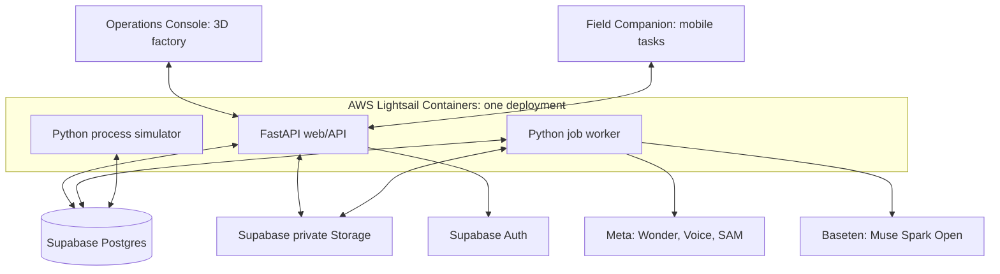
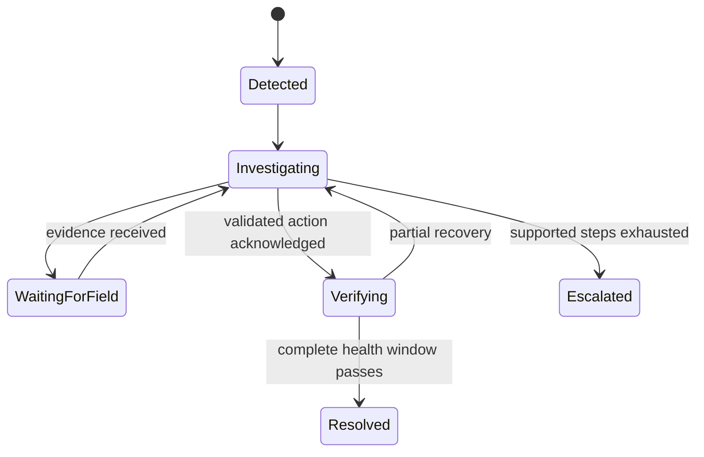

# FAULTGLASS architecture baseline

**Date:** 2026-11-01. **Status:** proposed implementation baseline; documentation
only. The repository does not yet implement this design. Provider capabilities
below were checked against official documentation; account access, latency,
Marathi accuracy and gauge-reading performance remain untested.

FAULTGLASS will investigate a simulated water-treatment incident using plant
structure, telemetry, SOPs and evidence collected by a person. The reusable core
owns investigation, evidence and persistence; each site supplies its equipment,
connections, limits and procedures. The first demonstration covers one treatment
section, with a credible operating model and recoverable workflow.

## 1. Languages, deployment and interfaces

| Component | Choice | Responsibility |
| --- | --- | --- |
| Web application | React, TypeScript, Vite | Both interfaces, responsive layouts, charts and evidence capture |
| 3D factory view | Three.js through React Three Fiber | Browser-rendered equipment, pipe connections, flow animation and inspection highlights |
| Operations Console | `/operations`; Operations Lead | Plant overview, incidents, assignments and verification |
| Field Companion | `/field`; Field Technician | Equipment location, tasks, photos, audio and completion |
| Backend | Python, FastAPI | Authorized APIs, domain logic, model tools and event streaming |
| Database | Supabase Postgres | Authoritative plant releases, telemetry, incidents and jobs |
| Identity/files | Supabase Auth and private Storage | User identity and protected evidence/documents |
| Durable jobs | Procrastinate with Postgres | Model work, evidence processing and resumable steps |
| Hosting | AWS Lightsail Containers | One deployment containing web/API, worker and simulator containers |

One multi-stage Docker build compiles the frontend and includes its static files
in the Python image. FastAPI serves them and the API from one public Lightsail
HTTPS address. Three containers use the same codebase/image with different startup
commands: web/API, background worker and simulator. The web/API container is the
public endpoint; the other two run in the same deployment. Lightsail manages the
HTTPS endpoint and container runtime. [AWS Lightsail deployments](https://docs.aws.amazon.com/lightsail/latest/userguide/amazon-lightsail-container-services-deployments.html)

Vite builds the TypeScript frontend; React Three Fiber connects React components
to Three.js rendering. Its documentation supports Vite directly. The 3D scene runs
on the user's device, while Python owns the process simulation. A server GPU is
not required for this architecture: model inference runs on Meta/Baseten.
[React Three Fiber installation](https://r3f.docs.pmnd.rs/getting-started/installation)

Supabase supplies a full Postgres database. Private Storage objects require
authorized access or time-limited signed URLs. Originals never depend on a
container's temporary filesystem. [Supabase database](https://supabase.com/docs/guides/database/overview),
[private buckets](https://supabase.com/docs/guides/storage/buckets/fundamentals)

Use the Supabase free tier within its limits and eligible AWS credits for Lightsail
usage. Hosting is paid usage offset by credits, not a permanently free service.
Confirm credit eligibility, expiry and remaining balance before provisioning;
Meta and Baseten usage has separate billing or credits. Deployment size remains
to be measured during implementation. [AWS credits](https://docs.aws.amazon.com/us_en/awsaccountbilling/latest/aboutv2/useconsolidatedbilling-credits.html),
[Supabase plans](https://supabase.com/pricing)



Use REST for commands and authenticated `fetch` SSE for live events. Each event
has a durable cursor; reconnection replays missed events or reloads a current
snapshot if the cursor expired. The backend validates identity, site membership
and role on every operation. Field users receive assigned work and relevant
assets. All AI requests and provider secrets remain server-side.

## 2. Where implementation belongs

The following is the proposed organization; the existing scaffold has not been
reorganized:

```text
frontend/                    React/TypeScript application and shared UI types
  src/scene/                 Three.js factory, equipment meshes and state animation
backend/app/
  api/                       REST, authentication and SSE
  plant/                     releases, topology and locations
  telemetry/                 ingestion, quality and alert detection
  workflow/                  incidents, tasks, jobs and transitions
  agents/                    Wonder orchestration and provider adapters
  evidence/                  uploads, audio conversion and image results
  memory/                    retrieval, summaries and site knowledge
  policy/                    action validation and recovery rules
  simulation/                dynamics, clock and action consumption
plants/demo-water/           shareable versioned demonstration plant pack
migrations/                  database and job schema changes
tests/                       integration and scenario verification
```

Python schemas validate model outputs and API inputs. Published API contracts
provide the frontend's types. Begin with relational tables, JSON fields where
appropriate and Postgres text search; additional databases are unnecessary.

## 3. Plant structure, locations and versions

Maintain three representations connected by stable asset IDs:

| Representation | Contents | Consumer |
| --- | --- | --- |
| Process graph | Equipment, ports, directed pipe edges, branches, instruments and dependencies | AI tools and process schematic |
| Spatial layout | Floor plan, zones, coordinates, landmarks and reference photos | Operations view and field navigation |
| 3D scene | Equipment geometry, transforms, pipe paths and visual bindings | React Three Fiber factory view |

The AI traverses explicit pipe connections. Floor-plan pixels do not establish
process connectivity. Selecting an asset highlights it across the 3D scene,
process schematic and floor plan. A task
includes its plain-language name, zone, highlighted position and reference photo;
the returned evidence remains linked to that equipment and assignment.

The repository plant pack contains a manifest, assets, connections, instruments,
locations, scene definitions, capabilities, typed rules and safe demo SOPs. Confidential actual
floor plans, SOP documents and factory photos stay in private Storage, with
metadata in Postgres. Import validation creates an immutable plant release with
hashes and references. Publishing changes creates another release.

Each incident pins plant, layout, scene, SOP and rule versions, plus simulator run,
simulator version and seed. Stable asset IDs persist across releases; revised
records preserve history. A changed layout cannot silently redirect an existing
field assignment. An alternate filtered route exists only when the imported
topology explicitly contains it.

The 3D view consumes authoritative state updates through the backend. It animates
flow, tank levels, equipment state and the current inspection target. Visual
interpolation smooths updates but cannot change measurements or determine recovery.
Equipment selection resolves to the same asset record used by diagnostic tools.
Ordinary scene payloads contain observable state, not hidden faults or private
gauge readings. Local dial evidence is revealed through the inspection workflow.

## 4. Instruments and central telemetry

An instrument is attached to an equipment port or pipe edge, with a measured
quantity, unit and permitted observation methods. Example:

| Field | Local filter-inlet gauge | Digital outlet-flow meter |
| --- | --- | --- |
| Measurement point | Cartridge-filter inlet port | RO product outlet edge |
| Quantity/unit | Pressure / bar | Flow / litres per minute |
| Observation method | Photo or technician entry | Digital telemetry |
| Binding | Field task and evidence reference | Source ID and signal key |
| Location | Treatment room, left filter gauge | RO outlet instrument position |

A digital binding additionally records connector type, sampling expectation,
freshness limit and server-side credential reference. Both simulator and future
real connectors publish the same reading contract: signal ID, value, unit,
observed time, received time, quality, provenance and release/run reference.

Maintain current readings for fast display and timestamped history for trends.
Missing or stale readings remain unknown. Normalize units before comparison.
Reported, commanded and verified equipment states remain distinguishable.

For a local gauge, the model-facing query returns its location and available
inspection methods. It cannot query the simulator's private gauge value. A field
observation must supply that evidence. This makes the inspection consequential.

## 5. Stored records and five memory groups

| Memory | Authoritative records | Retrieval into the investigation |
| --- | --- | --- |
| Plant memory | Releases, assets, ports, edges, instruments, locations | Relevant graph neighborhood and capabilities |
| SOP memory | Original files, immutable revisions, extracted sections | Applicable sections with document/page references |
| Incident memory | State, tasks, evidence, public hypotheses, actions, summaries | Completed checks, open questions and fresh evidence |
| Historical memory | Closed incidents, maintenance, interventions, outcomes | Relevant prior cases with dates and provenance |
| Site knowledge | Explicit operator assertions, author, scope, validity, confirmation | Applicable sourced facts, corrections and exceptions |

Other tables preserve telemetry, evidence hashes and object references, model
runs, event history, verification windows, action acknowledgements and jobs.
Use current-state rows plus append-only events; full event sourcing is unnecessary.

Original SOPs support explanation and citations. Executable limits live in typed
rule records: units, allowed operations, required evidence, operating envelopes,
task budgets and recovery conditions. SOP prose alone cannot enforce limits.

Historical diagnoses remain conclusions with supporting evidence. They do not
automatically become permanent plant facts. Technician corrections supersede
derived readings while retaining the original result and correction provenance.
Retrieval filters by site, release, asset, validity and task before searching text.
The model receives selected records through tools; it has no unrestricted database
access.

## 6. Durable investigation and action execution



Alert detection opens an incident. The worker builds context and calls Wonder.
Wonder selects a check or proposes an available action. Backend validation checks
asset IDs, capabilities, prerequisites, evidence and limits before dispatch.
Waiting is a persisted state: no HTTP request, model request or process waits
open for the technician.

Evidence submission commits a result and schedules reassessment. State, events
and job enqueue must be atomic: use a shared database transaction/connection or
a transactional outbox. Start with the outbox if connector integration makes a
shared transaction awkward. Job handlers use incident revision checks and
idempotency keys; obsolete results cannot overwrite a newer incident state.
Media progresses through `pending → uploaded → processed`; processing jobs begin
only after upload confirmation.

Use a direct/session database connection suitable for queue notifications, or
configured polling; do not assume transaction pooling preserves session features.
Configure bounded retries, timeouts, backoff and explicit terminal errors.
Procrastinate requires explicit recovery of jobs abandoned by dead workers.
Reclaim stalled jobs at worker startup and periodically using heartbeat checks,
with settings aligned to shutdown and retry behavior. [Procrastinate stalled-job recovery](https://procrastinate.readthedocs.io/en/stable/howto/production/retry_stalled_jobs.html)

Accepted simulation actions enter a durable inbox with unique `action_id`.
The simulator atomically records application and acknowledgement. Redelivery
returns that acknowledgement rather than applying the action twice. Recovery
verification begins from acknowledged state and fresh subsequent telemetry.
External model calls can repeat after a crash; state transitions and actions
must remain idempotent.

## 7. Meta models and Baseten

| Role | Selected model/provider | Contribution |
| --- | --- | --- |
| Lead investigator | `muse-wonder-1.0`, Meta Responses API | Select tools/checks, connect evidence, revise hypotheses and resume investigations |
| Speech | `muse-voice-transcribe-1.0`, Meta | Convert technician audio into a transcript |
| Segmentation | `sam-3.1`, Meta | Locate relevant gauges/equipment and produce masks |
| Evidence interpretation | `meta-models/muse-spark-open`, Baseten | Read useful image crops and normalize transcripts into candidate observations |

Meta documents Wonder for tool-driven agent work, Voice for transcription and
SAM for boxes/masks. Muse Image generates/edits images; reserve it for optional
labeled illustrations, not gauge reading. Muse Code is a development agent,
not a runtime inference model ID. [Meta model catalog](https://dev.meta.ai/docs/models)

Baseten's catalog exposes the selected Spark Open slug. Call
`https://inference.baseten.co/v1/chat/completions`. This gives Baseten a real
evidence-processing role while Wonder owns diagnosis. Spark Open does not support
Baseten structured outputs or JSON mode: parse and validate candidates in Python,
allow a bounded repair attempt, then return uncertainty or request clarification.
[Spark Open listing](https://www.baseten.co/library/muse-spark-open/),
[Baseten API capabilities](https://docs.baseten.co/inference/model-apis/overview)

Marathi is officially supported by Voice. Start with short recorded uploads;
the backend converts browser audio to mono, 16-bit PCM WAV at 16 or 24 kHz before
submission. Preserve the original recording and transcript, then normalize
equipment names and observations separately. Real factory noise and Marathi
equipment vocabulary still require testing. [Speech-to-text requirements](https://dev.meta.ai/docs/speech-to-text)

For images, retain the original, segmentation mask, crop and derived reading.
SAM identifies regions; Spark Open interprets the crop. A reading includes asset,
quantity, unit, evidence reference and uncertainty. Ambiguous needles, unreadable
scales or mismatched equipment produce another check, not invented precision.

## 8. Continuity and visible model work

Wonder's continuation is separate from the five application memories. Use
`store: false` with `include: ["reasoning.encrypted_content"]`, persist returned
continuation items privately and replay them intact alongside required messages
and tool results. Opaque items cannot be rewritten; manage context at whole-turn
boundaries. Application records remain sufficient to start a fresh investigation
context if continuation is unavailable. [Responses continuation](https://dev.meta.ai/docs/protocols/responses)

Request `reasoning.summary: "concise"` for a visible explanation where provided.
Raw internal reasoning remains private. [Reasoning summaries](https://dev.meta.ai/docs/reasoning)

Meta describes Active Memory as recalling relevant context and Active Focus as
sustaining progress and adapting across obstacles. The demo demonstrates those
behaviors through observable work. [Muse Wonder capabilities](https://research.meta.ai/blog/muse-wonder)

Operations Console shows current focus from selected asset IDs and the next
check; memory recalled from actual retrieved/cited source IDs; completed checks;
public hypotheses with evidence for/against; a durable task timeline; recovery
trends; and provider activity with model, latency and result. These panels do not
claim access to native attention maps or calibrated confidence. A failed check
followed by a justified revised task is the clearest focus demonstration.
Link each focus/task event to a highlight in the 3D scene, and link recalled
records to their equipment and source. These highlights reflect actual tool/task
targets rather than invented internal model attention.

## 9. Simulation that supports investigation

Build a reduced-order demonstration surrogate for one treatment section: feed
tank, supply/pump path, filter, RO unit, product tank and reject outlet. Include
only explicitly configured branches, and label a synthetic demonstration layout
separately from a surveyed plant. Track bounded tank inventories, pressure/flow responses,
RO feed/product/reject balance, actuator state and settling after actions.
Parameters are demonstration settings, not a validated hydraulic digital twin.

The simulator advances on its own clock during model calls and field pauses.
Persist clock position, state and seed; one clock lease permits one simulator
to advance each run. Keep observed time separate from receipt time and clearly
indicate any accelerated simulation speed.

Three.js displays the published state of this simulation. Python calculates the
process behavior; the browser renders it. A technician action travels through the
API and validator to the simulator, and its resulting state travels back to both
interfaces. Reloading a browser reconstructs the scene from saved configuration
and current observable state.

Private fault truth lives in a restricted schema. The simulator has its own
database role; the API/planner worker's credentials cannot read that schema.
Never give that worker an all-powerful database credential. Shared job payloads
contain opaque IDs, never fault labels/parameters; queue names provide no isolation.
Restricted demo-administration controls inject/reset scenarios separately from
ordinary incident endpoints. Fault labels never enter normal UI events or model
tools. The public contract exposes observations and action acknowledgements only.

Recommend three independent causes of low output:

| Scenario | Distinguishing evidence |
| --- | --- |
| Filter restriction | Local pressure difference and downstream response |
| Insufficient feed supply | Feed inventory/supply observations and flow behavior |
| Reduced RO productivity | Feed conditions, product/reject behavior and history |

Avoid diagnosing cavitation or scaling without evidence specific to those causes.
Use one complete walkthrough and two shorter runs. Each scenario defines initial
conditions, hidden fault, visible signals, inspection fixtures, allowed actions,
response dynamics and expected verification outcomes.

Generate synthetic gauge images deterministically from the same simulator state
and timestamp as their readings. Label real, synthetic and replay evidence. A
normal camera photo cannot prove a simulated abnormal pressure. Store fixture
provenance, and deliver local readings only through completed inspection tasks.

Recovery requires every configured health condition to hold for the full window,
with fresh readings and acceptable inventory, pressure, flow and quality signals
where configured. Partial recovery resumes investigation. The backend verifier,
not a model statement, closes the incident.

## 10. Build order and acceptance

| Priority | Milestone | Exit evidence |
| --- | --- | --- |
| P0 | Provider access and sample evidence | Successful authorized API tests, Marathi transcript and gauge assessment |
| P0 | Plant releases, 3D view, maps and simulator | One asset identity across views, consistent baseline and the primary filter-restriction fault |
| P0 | Durable incident/task loop | Pause, restart and evidence resumption work |
| P1 | Wonder, Voice, SAM and Baseten integration | Live model results drive validated investigation steps |
| P1 | Both interfaces and model-work panels | A technician completes a task from a phone |
| P1 | Additional scenarios and memory reuse | Two alternative causes produce different checks; a later incident retrieves applicable prior knowledge |
| P1 | Failure rehearsals and demo recording | Acceptance checks below pass with saved run records |

Meaningful pass/fail checks:

1. Every task target resolves to the same asset in the 3D scene, process and floor maps.
2. A new plant release leaves an active incident's pinned configuration unchanged.
3. Planner tools and credentials cannot retrieve private faults or local readings.
4. Restart during a field pause preserves assignment, evidence and investigation.
5. Killing a worker recovers its stalled job without duplicate task dispatch.
6. Replaying an accepted action applies it once and preserves its acknowledgement.
7. Unreadable/wrong-asset images request clarification without inventing readings.
8. Duplicate submissions, malformed model output and provider timeout preserve state.
9. Partial recovery, stale signals or a failed health condition prevent closure.
10. All three scenarios produce evidence-consistent investigations, and SSE reconnect
    restores current state and missed events.

The target is a reproducible, inspectable demonstration with defined failure
behavior. Account access, site-specific evidence and measured reliability must be
established during implementation. Start with endpoint checks and one complete
investigation before expanding the scenario set.
